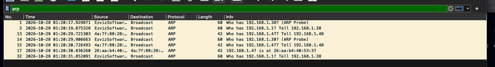
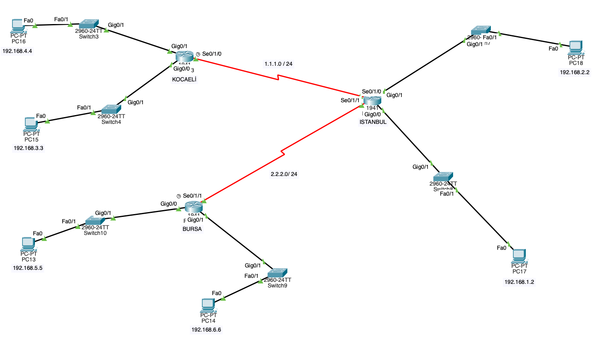
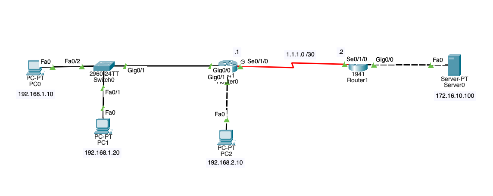
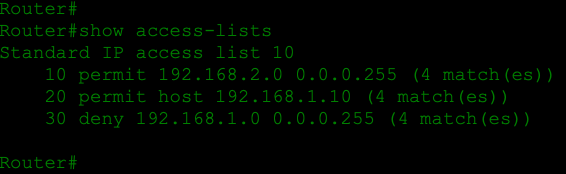

# CCNA Labs

This repository holds the hands-on networking labs I build while preparing for the Cisco Certified Network Associate (CCNA) certification. Most labs are built in Cisco Packet Tracer; some use Wireshark to look at real traffic on my own network.

Each lab folder contains the `.pkt` file, so you can open it in Packet Tracer and look at the configuration yourself. The repo grows as I work through new CCNA topics.

## Labs

| # | Lab | Topic | Tools | Folder |
|---|-----|-------|-------|--------|
| 1 | [ARP Protocol Test](#1-arp-protocol-test) | ARP requests, replies and probes | Packet Tracer, Wireshark | [`arp_protocol_test/`](arp_protocol_test/) |
| 2 | [Static Routing](#2-static-routing) | Static routes between three routers | Packet Tracer | [`staticrouting/`](staticrouting/) |
| 3 | [Standard ACL](#3-standard-acl) | Filtering traffic by source address | Packet Tracer | [`standartACL/`](standartACL/) |

---

## 1. ARP Protocol Test

ARP (Address Resolution Protocol) maps an IPv4 address to a MAC address inside a local network. In this lab I captured live ARP traffic with Wireshark, using the `arp` display filter.



What the capture shows:

- **ARP requests are broadcast.** `Who has 192.168.1.1? Tell 192.168.1.38` goes to every device on the LAN, here a host looking up the MAC of its default gateway.
- **ARP replies are unicast.** `192.168.1.47 is at 26:aa:b4:40:53:37` goes straight back to the device that asked (`192.168.1.48`).
- **ARP probes.** `Who has 192.168.1.38? (ARP Probe)` is a device checking that nobody else is already using the address it wants before it claims it (duplicate address detection).
- **Retries.** When no reply arrives, the same request is sent again (`192.168.1.47` was asked twice before it answered).

Files: [`arp_protocol_test.pkt`](arp_protocol_test/arp_protocol_test.pkt), [`ARP_TRAFIK.png`](arp_protocol_test/ARP_TRAFIK.png)

---

## 2. Static Routing

Three 1941 routers, named after cities, are connected over serial links. Each router has two LANs behind it, and the goal is for every PC to reach every other PC using only static routes.



| Router   | LAN (interface)              | Host             | WAN link                       |
|----------|------------------------------|------------------|--------------------------------|
| KOCAELİ  | 192.168.3.0/24 (Gig0/0)      | PC15 192.168.3.3 | Se0/1/0 → ISTANBUL (1.1.1.0/24) |
|          | 192.168.4.0/24 (Gig0/1)      | PC16 192.168.4.4 |                                |
| ISTANBUL | 192.168.1.0/24 (Gig0/0)      | PC17 192.168.1.2 | Se0/1/0 → KOCAELİ (1.1.1.0/24) |
|          | 192.168.2.0/24 (Gig0/1)      | PC18 192.168.2.2 | Se0/1/1 → BURSA (2.2.2.0/24)   |
| BURSA    | 192.168.5.0/24 (Gig0/0)      | PC13 192.168.5.5 | Se0/1/1 → ISTANBUL (2.2.2.0/24) |
|          | 192.168.6.0/24 (Gig0/1)      | PC14 192.168.6.6 |                                |

ISTANBUL is the hub. A router only knows its directly connected networks, so each one needs a static route for every remote LAN:

| Router   | Networks it must learn statically                    | Next hop    |
|----------|------------------------------------------------------|-------------|
| KOCAELİ  | 192.168.1.0, 192.168.2.0, 192.168.5.0, 192.168.6.0, 2.2.2.0 | ISTANBUL |
| BURSA    | 192.168.1.0, 192.168.2.0, 192.168.3.0, 192.168.4.0, 1.1.1.0 | ISTANBUL |
| ISTANBUL | 192.168.3.0, 192.168.4.0                              | KOCAELİ     |
|          | 192.168.5.0, 192.168.6.0                              | BURSA       |

The general form of the command:

```
ip route <destination-network> <subnet-mask> <next-hop-ip | exit-interface>
```

Since KOCAELİ and BURSA have only one way out, a default route (`ip route 0.0.0.0 0.0.0.0 <next-hop>`) toward ISTANBUL would also work on them.

Files: [`staticrouting.pkt`](staticrouting/staticrouting.pkt), [`staticrouting.png`](staticrouting/staticrouting.png)

---

## 3. Standard ACL

A standard IP access list controls which hosts can reach the server at `172.16.10.100`. PC2's network and PC0 are allowed; the rest of `192.168.1.0/24` (PC1) is blocked.



```
access-list 10 permit 192.168.2.0 0.0.0.255
access-list 10 permit host 192.168.1.10
access-list 10 deny 192.168.1.0 0.0.0.255
```

A standard ACL only checks the source address, so it goes as close to the destination as possible and is applied outbound on the interface facing the server. Rule order matters: the `permit host` line has to come before the `deny` for its subnet.

After pinging the server from all three PCs, `show access-lists` shows every rule matching traffic:



Full write-up: [`standartACL/README.md`](standartACL/README.md)

---

## Repository Structure

```
CCNA/
├── README.md
├── arp_protocol_test/
│   ├── arp_protocol_test.pkt
│   └── ARP_TRAFIK.png
├── staticrouting/
│   ├── staticrouting.pkt
│   └── staticrouting.png
└── standartACL/
    ├── README.md
    ├── standartACL.pkt
    ├── standartACL.png
    └── show-access-lists.png
```

## How to Use

1. Install [Cisco Packet Tracer](https://www.netacad.com/courses/packet-tracer).
2. Clone the repo: `git clone <repo-url>`
3. Open any `.pkt` file in Packet Tracer to see the topology and device configs.
