# CCNA Labs

This repository contains the hands-on networking labs I create while preparing for the **Cisco Certified Network Associate (CCNA)** certification.

Most of my labs are developed using **Cisco Packet Tracer**, while some involve **Wireshark** to analyze real network traffic.

I use this repository to document my learning progress, practice Cisco IOS configurations, troubleshoot networking problems, and develop practical networking skills.

Each lab contains its Packet Tracer project file (`.pkt`) and, where available, network topology screenshots, configuration outputs, and testing results.

This repository will continue to grow as I explore new networking topics throughout my CCNA preparation.

---

## Labs

| # | Lab | Topics | Tools | Folder |
|---|---|---|---|---|
| 1 | [ARP Protocol Test](#1-arp-protocol-test) | ARP requests, replies, broadcast communication | Wireshark, Packet Tracer | [arp_protocol_test](arp_protocol_test/) |
| 2 | [Static Routing](#2-static-routing) | Static routes, routing tables, inter-network communication | Packet Tracer | [staticrouting](staticrouting/) |
| 3 | [Standard ACL](#3-standard-acl) | Source IP filtering, wildcard masks | Packet Tracer | [standartACL](standartACL/) |
| 4 | [Extended ACL](#4-extended-acl) | Protocol, port, source and destination filtering | Packet Tracer | [extendedACL](extendedACL/) |
| 5 | [Telnet ACL](#5-telnet-acl) | VTY access control, remote management restrictions | Packet Tracer | [telnetACL](telnetACL/) |
| 6 | [Named Standard ACL](#6-named-standard-acl) | Named ACLs, source IP filtering | Packet Tracer | [namedStandartACL](namedStandartACL/) |
| 7 | [Named Extended ACL](#7-named-extended-acl) | HTTP, DNS, FTP and ICMP traffic filtering | Packet Tracer | [namedExtendedACL](namedExtendedACL/) |
| 8 | [DHCP on Router](#8-dhcp-on-router) | DHCP pools, automatic IP allocation, DHCP bindings | Packet Tracer | [DHCPonRouter](DHCPonRouter/) |

---

## 1. ARP Protocol Test

**Topic:** Address Resolution Protocol (ARP)

In this lab, I explored how devices use ARP to resolve IPv4 addresses into MAC addresses within a local network.

I used Wireshark to capture and analyze ARP traffic generated by devices on my network.

### ARP Traffic Analysis


The packet capture demonstrates several important ARP behaviors:

- **ARP Request:** A device broadcasts a request to discover the MAC address associated with an IPv4 address.
- **ARP Reply:** The requested device responds with its MAC address, typically using unicast communication.
- **ARP Probe:** A device checks whether an IPv4 address is already in use before assigning it.
- **ARP Retransmission:** A device may repeat an ARP request when a response is not received immediately.

### What I Practiced

- Understanding IPv4-to-MAC address resolution
- ARP requests and replies
- Broadcast and unicast traffic
- ARP table behavior
- Capturing network traffic using Wireshark
- Analyzing packet information

**Lab Files:** [ARP Protocol Test](arp_protocol_test/)

---

## 2. Static Routing

**Topic:** Static Routing and Inter-Network Communication

In this lab, I configured a network consisting of three Cisco 1941 routers connected through serial links.

Each router connects to different local area networks.

The objective was to establish communication between all networks by manually configuring static routes.

### Network Topology


### Configuration

Static routes were configured using the following command structure:

```cisco
ip route <destination-network> <subnet-mask> <next-hop-ip>
```

Each router required routes to reach networks that were not directly connected.

I configured the appropriate destination networks, subnet masks, and next-hop addresses to establish communication between devices.

### What I Practiced

- Static routing configuration
- Router interface IP addressing
- Serial connections between routers
- Next-hop IP addresses
- Routing table verification
- Inter-network communication
- Troubleshooting connectivity issues

### Useful Commands

```cisco
show ip route
show ip interface brief
show running-config
ping
traceroute
```

**Lab Files:** [Static Routing](staticrouting/)

---

## 3. Standard ACL

**Topic:** Standard Access Control Lists

In this lab, I configured a numbered Standard ACL to control network access based on source IPv4 addresses.

The objective was to permit selected devices to communicate with a server while restricting other devices.

### Network Topology


### ACL Configuration

```cisco
access-list 10 permit 192.168.2.0 0.0.0.255
access-list 10 permit host 192.168.1.10
access-list 10 deny 192.168.1.0 0.0.0.255
```

Standard ACLs examine only the source IPv4 address of a packet.

Because of this limitation, Standard ACLs are generally placed close to the destination network.

The order of ACL statements is important because Cisco routers evaluate ACL entries from top to bottom and stop at the first matching rule.

### ACL Verification


### What I Practiced

- Configuring numbered Standard ACLs
- Source IPv4 address filtering
- Wildcard masks
- Permit and deny statements
- ACL sequence and rule ordering
- Applying ACLs to router interfaces
- Understanding implicit deny
- Verifying ACL match counters

**Lab Files:** [Standard ACL](standartACL/)

---

## 4. Extended ACL

**Topic:** Extended Access Control Lists

In this lab, I configured a numbered Extended ACL to control network traffic based on source address, destination address, protocol, and destination port.

Extended ACLs provide more precise filtering compared to Standard ACLs.

### Network Topology

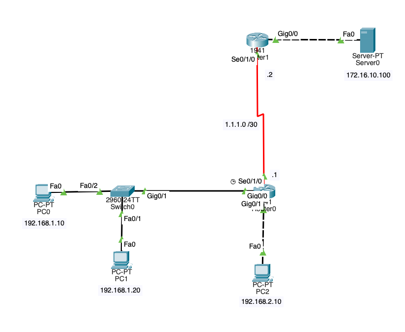

### Objective

The objective was to allow a specific PC to access an FTP server while preventing unauthorized devices from using FTP.

ICMP traffic was permitted separately to maintain ping connectivity.

### ACL Configuration

```cisco
access-list 105 permit tcp host 192.168.1.10 host 172.16.10.100 eq ftp
access-list 105 deny tcp 192.168.1.0 0.0.0.255 host 172.16.10.100 eq ftp
access-list 105 permit icmp any any
```

The first rule allows the authorized PC to access the FTP service.

The second rule blocks FTP access from other devices in the specified subnet.

The third rule permits ICMP traffic.

Any traffic that does not match these rules is blocked by the implicit deny statement.

### Connectivity Testing

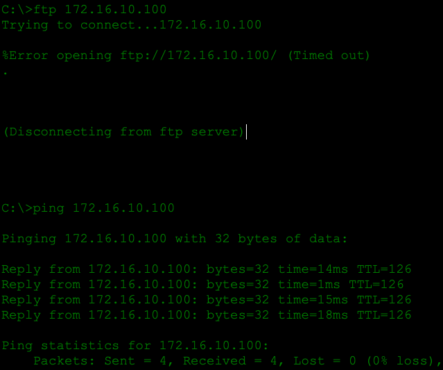

### ACL Verification

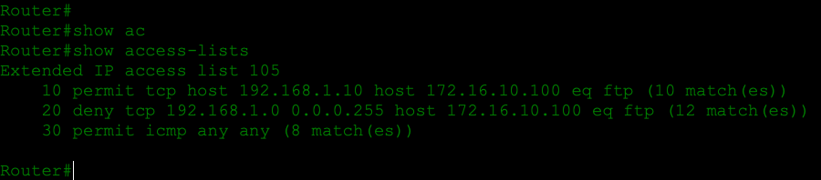

### What I Practiced

- Configuring numbered Extended ACLs
- Filtering TCP traffic
- Restricting FTP access
- ICMP traffic control
- Source and destination IP matching
- Port-based filtering
- Understanding ACL placement
- Troubleshooting ACL-related connectivity issues

**Lab Files:** [Extended ACL](extendedACL/)

---

## 5. Telnet ACL

**Topic:** Securing Remote Router Access

In this lab, I configured an ACL to restrict Telnet access to a Cisco router.

The objective was to allow an authorized administrator to access the router remotely while blocking unauthorized devices.

### Network Topology

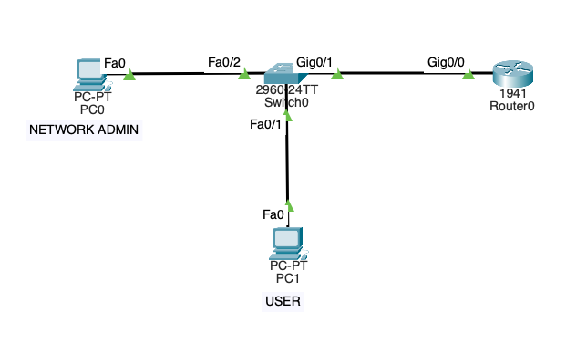

### ACL Configuration

```cisco
access-list 10 permit host 192.168.1.3
access-list 10 deny any

line vty 0 4
 access-class 10 in
```

Unlike interface-based ACLs, this ACL was applied directly to the router's VTY lines.

The `access-class` command restricts remote access to the router, while `ip access-group` is used to filter traffic on router interfaces.

### Configuration Output

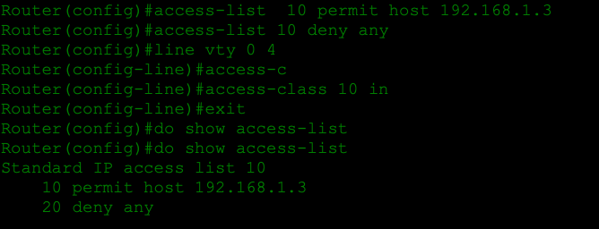

### What I Practiced

- Telnet remote access
- VTY line configuration
- Standard ACL implementation
- Restricting administrative access
- Using `access-class`
- Understanding router management security

**Security Note:** Telnet transmits data without encryption. SSH is the preferred protocol for secure remote administration.

**Lab Files:** [Telnet ACL](telnetACL/)

---

## 6. Named Standard ACL

**Topic:** Named Standard Access Control Lists

In this lab, I practiced configuring Standard ACLs using descriptive names instead of numerical identifiers.

Named ACLs make access control configurations easier to identify, organize, and manage.

Like numbered Standard ACLs, Named Standard ACLs filter traffic based on source IPv4 addresses.

### Network Topology

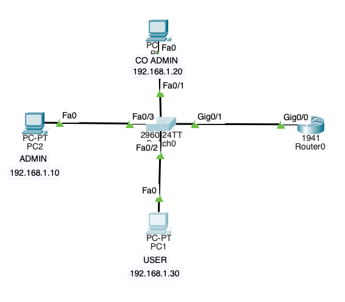

### Example Configuration

```cisco
ip access-list standard NETWORK-ACCESS
 permit host 192.168.1.10
 deny 192.168.1.0 0.0.0.255
```

This example demonstrates how a Named Standard ACL can permit a specific host while denying other devices from the same subnet.

The Packet Tracer project contains the actual lab configuration.

### ACL Verification

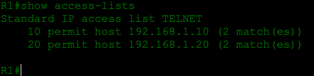

### What I Practiced

- Creating Named Standard ACLs
- Source IP address filtering
- Managing ACL rules
- Using sequence numbers
- Understanding permit and deny statements
- Applying ACLs to router interfaces
- Verifying ACL configurations
- Understanding implicit deny behavior

### Useful Commands

```cisco
show access-lists
show ip interface
show running-config
```

**Lab Files:** [Named Standard ACL](namedStandartACL/)

---

## 7. Named Extended ACL

**Topic:** Named Extended ACLs and Protocol-Based Traffic Filtering

In this lab, I configured Named Extended ACLs to control access to network services using source and destination addresses, transport protocols, and port numbers.

The topology includes two Cisco routers, multiple client devices, a WEB-DNS server, and an FTP server.

The objective was to practice service-specific access restrictions and understand how ACL placement affects network communication.

### Network Topology

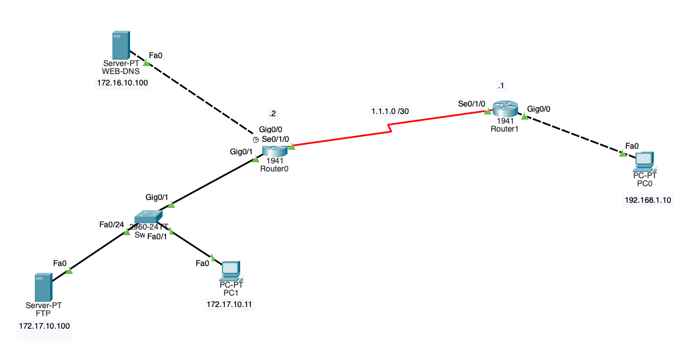

### Network Devices

| Device | IP Address | Role |
|---|---|---|
| WEB-DNS Server | 172.16.10.100 | HTTP and DNS services |
| FTP Server | 172.17.10.100 | FTP service |
| PC0 | 192.168.1.10 | Remote client |
| PC1 | 172.17.10.11 | Authorized FTP client |
| PC2 | 172.17.10.45 | Additional test client |
| Router0 G0/0 | 172.16.10.1 | WEB-DNS network gateway |
| Router0 G0/1 | 172.17.10.1 | FTP network gateway |

The two routers are connected through the `1.1.1.0/30` serial network.

### WEB-DNS Server ACL

I configured a Named Extended ACL called `PING-ENGELLEME`.

The objective was to permit HTTP and DNS communication while preventing external devices from sending ICMP Echo Requests to the WEB-DNS server.

### ACL Configuration

```cisco
ip access-list extended PING-ENGELLEME
 10 permit tcp any host 172.16.10.100 eq www
 20 permit icmp host 172.16.10.100 any echo
 30 deny icmp any host 172.16.10.100 echo
 40 permit icmp any host 172.16.10.100 echo-reply
 50 permit udp any host 172.16.10.100 eq domain
 60 permit tcp any host 172.16.10.100 eq domain
```

The ACL was applied to the interface facing the WEB-DNS server:

```cisco
interface GigabitEthernet0/0
 ip access-group PING-ENGELLEME out
```

### Traffic Filtering

| Protocol | Destination | Action |
|---|---|---|
| HTTP (TCP 80) | WEB-DNS Server | Permit |
| DNS (UDP 53) | WEB-DNS Server | Permit |
| DNS (TCP 53) | WEB-DNS Server | Permit |
| ICMP Echo Request | WEB-DNS Server | Deny |
| ICMP Echo Reply | WEB-DNS Server | Permit |

The ACL is evaluated from top to bottom.

Any IP packet that does not match an explicit permit or deny statement is blocked by the implicit deny rule.

### FTP Server ACL

I also configured an Extended Named ACL to control FTP access.

The goal was to allow PC1 to access the FTP server while preventing unauthorized clients from establishing FTP connections through the router.

```cisco
ip access-list extended FTP-KONTROL
 10 permit tcp host 172.17.10.11 host 172.17.10.100 eq 21
 20 deny tcp any host 172.17.10.100 eq 21
 30 deny icmp any host 172.17.10.100 echo
 40 permit icmp any host 172.17.10.100 echo-reply
 50 permit ip any any
```

The ACL was applied on Router0:

```cisco
interface GigabitEthernet0/1
 ip access-group FTP-KONTROL out
```

### Important Observation: Same-Subnet Traffic

During testing, I connected another PC to the same switch as the FTP server.

The additional device was able to access the FTP service despite the router ACL.

This happens because PC1, PC2, and the FTP server belong to the same `172.17.10.0/24` subnet.

Their traffic is switched locally and does not pass through Router0.

Therefore, the router ACL cannot filter communication between these devices.

To enforce restrictions between them, network segmentation using separate VLANs and subnets, or suitable switch-based access control, would be required.

### ACL Verification

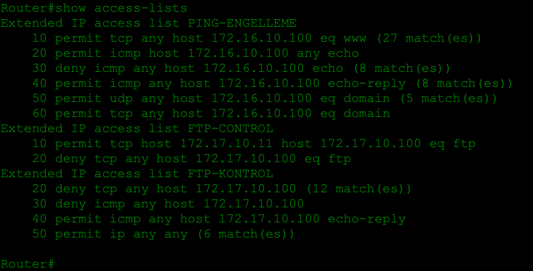

### What I Practiced

- Configuring Named Extended ACLs
- HTTP filtering using TCP port 80
- DNS filtering using UDP and TCP port 53
- FTP access restrictions using TCP port 21
- Controlling ICMP Echo Requests and Echo Replies
- ACL sequence numbers
- Inbound and outbound ACL directions
- Applying ACLs using `ip access-group`
- Troubleshooting network services
- Understanding same-subnet traffic behavior
- Understanding implicit deny

### Useful Commands

```cisco
show access-lists
show ip interface brief
show ip interface gigabitEthernet 0/0
show ip route
show running-config
```

**Lab Files:** [Named Extended ACL](namedExtendedACL/)

---

## 8. DHCP on Router

**Topic:** Dynamic Host Configuration Protocol (DHCP)

In this lab, I configured a Cisco 1941 router to function as a DHCP server using Cisco Packet Tracer.

The objective was to automatically assign IPv4 addresses to devices connected to the local network without manually configuring IP addresses on each device.

Instead of using a separate DHCP server, the Cisco router manages the DHCP address pool and distributes available addresses to clients.

### Network Topology

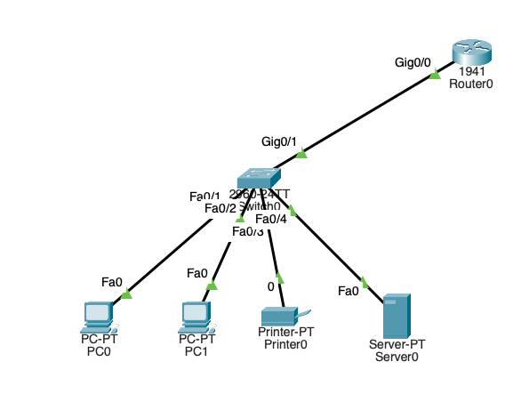

The topology consists of:

- 1 Cisco 1941 Router
- 1 Cisco 2960 Switch
- 2 PCs
- 1 Network Printer
- 1 Server

All devices are connected to the same local network through the switch.

### DHCP Pool Configuration

I created a DHCP pool named `HAVUZ` on the router.

The pool manages the `192.168.1.0/24` network and automatically assigns available IPv4 addresses to DHCP clients.

### DHCP Pool Verification

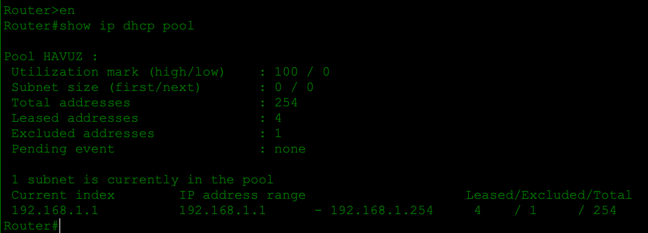

I used the following command to verify the DHCP pool:

```cisco
show ip dhcp pool
```

The command displays the configured address pool and its allocation statistics.

### DHCP Pool Information

| Parameter | Value |
|---|---|
| DHCP Pool | HAVUZ |
| Network | 192.168.1.0/24 |
| Total Addresses | 254 |
| Leased Addresses | 4 |
| Excluded Addresses | 1 |
| Pending Events | None |

The output confirms that the router successfully allocated four IPv4 addresses.

### DHCP Bindings

To examine which addresses were assigned to clients, I used:

```cisco
show ip dhcp binding
```

### DHCP Binding Output

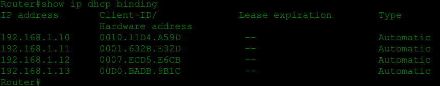

The router displayed the following DHCP bindings:

| Assigned IP Address | Client Hardware Address | Type |
|---|---|---|
| 192.168.1.10 | 0010.11D4.A59D | Automatic |
| 192.168.1.11 | 0001.632B.E32D | Automatic |
| 192.168.1.12 | 0007.ECD5.E6CB | Automatic |
| 192.168.1.13 | 00D0.BADB.9B1C | Automatic |

The binding table confirms that the router assigned IPv4 addresses to multiple devices.

### How DHCP Works: DORA

DHCP uses a four-step process known as DORA.

1. **Discover:** The client broadcasts a request to locate an available DHCP server.
2. **Offer:** The DHCP server offers an available IPv4 address.
3. **Request:** The client requests the selected IPv4 address.
4. **Acknowledge:** The server confirms the assignment.

DHCP uses UDP ports **67 (server)** and **68 (client)**.

DHCP can also provide additional network information such as:

- Subnet mask
- Default gateway
- DNS server
- IP address lease duration

### What I Practiced

- Configuring a Cisco router as a DHCP server
- Creating DHCP pools
- Automatic IPv4 address allocation
- Understanding DHCP bindings
- Verifying DHCP pool statistics
- Understanding excluded addresses
- Learning the DORA process
- Troubleshooting DHCP configurations
- Connecting multiple DHCP clients to a switch
- Using Cisco IOS DHCP verification commands

### Useful Commands

```cisco
show ip dhcp binding
show ip dhcp pool
show running-config
show ip interface brief
```

**Lab Files:** [DHCP on Router](DHCPonRouter/)

---

## Repository Structure

```text
CCNA/
├── README.md
│
├── arp_protocol_test/
│   ├── arp_protocol_test.pkt
│   └── ARP_TRAFIK.png
│
├── staticrouting/
│   ├── staticrouting.pkt
│   └── staticrouting.png
│
├── standartACL/
│   ├── README.md
│   ├── standartACL.pkt
│   ├── standartACL.png
│   └── show-access-lists.png
│
├── extendedACL/
│   ├── extendedACL.pkt
│   ├── topology.png
│   ├── ping-ftp-test.png
│   └── show-acl.png
│
├── telnetACL/
│   ├── telnetACL.pkt
│   ├── topology.png
│   └── acltelnetconfig.png
│
├── namedStandartACL/
│   ├── NamedACL.pkt
│   ├── showNamedaCL.png
│   └── topology.png
│
├── namedExtendedACL/
│   ├── extendedNamedACL.pkt
│   ├── showENACL.png
│   └── topology.png
│
└── DHCPonRouter/
    ├── dhcprouter.pkt
    ├── topology.png
    ├── bindings.png
    └── dhcppool.png
```

---

## How to Use

1. Install [Cisco Packet Tracer](https://www.netacad.com/courses/packet-tracer).
2. Clone this repository using Git:

```bash
git clone <repository-url>
```

3. Open any `.pkt` file using Cisco Packet Tracer.
4. Examine the network topology and device configurations.
5. Use the Cisco IOS CLI to verify network settings.
6. Test network connectivity and services using Ping, FTP, HTTP, DNS, or other tools used in the labs.

---

## Learning Progress

This repository documents my practical learning journey as I prepare for the **Cisco Certified Network Associate (CCNA)** certification.

My focus is on developing a strong understanding of networking fundamentals, learning Cisco IOS configurations, analyzing network traffic, and improving my troubleshooting skills.

Each lab represents a topic I have studied and practiced in a simulated or real networking environment.

I will continue updating this repository as I learn new CCNA topics and gain more practical experience.
